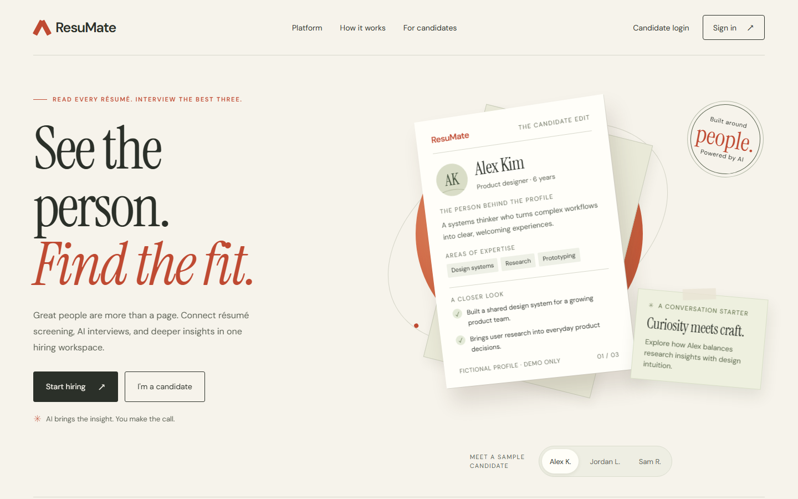
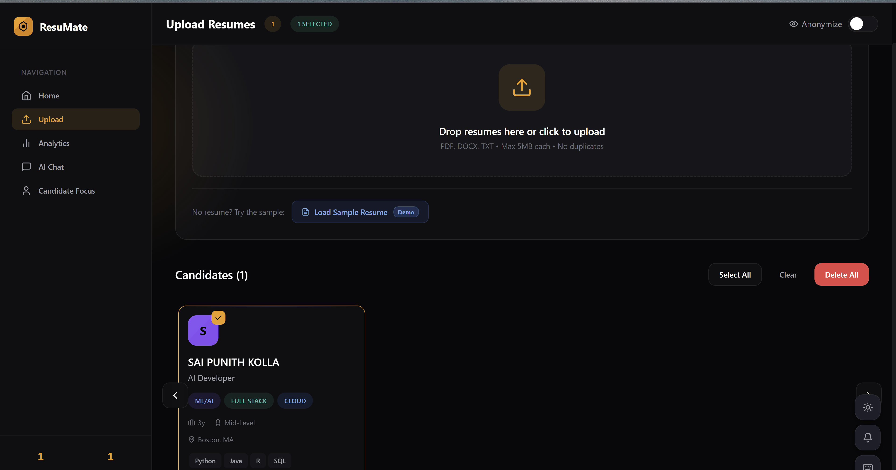
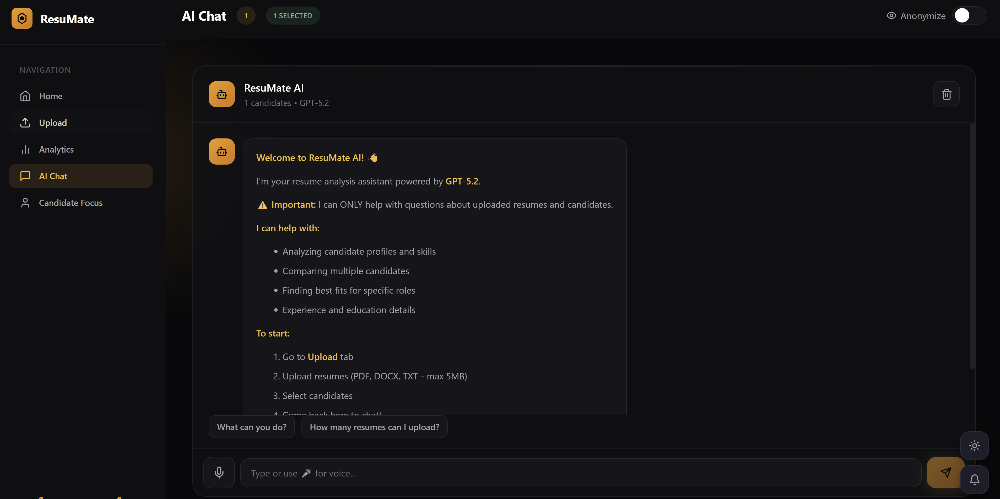
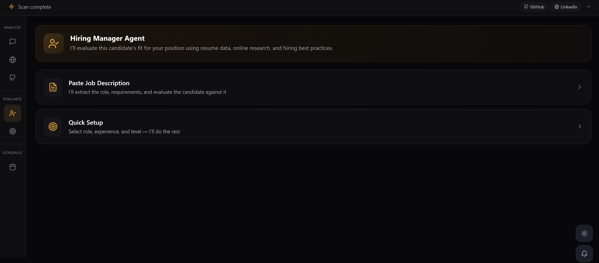
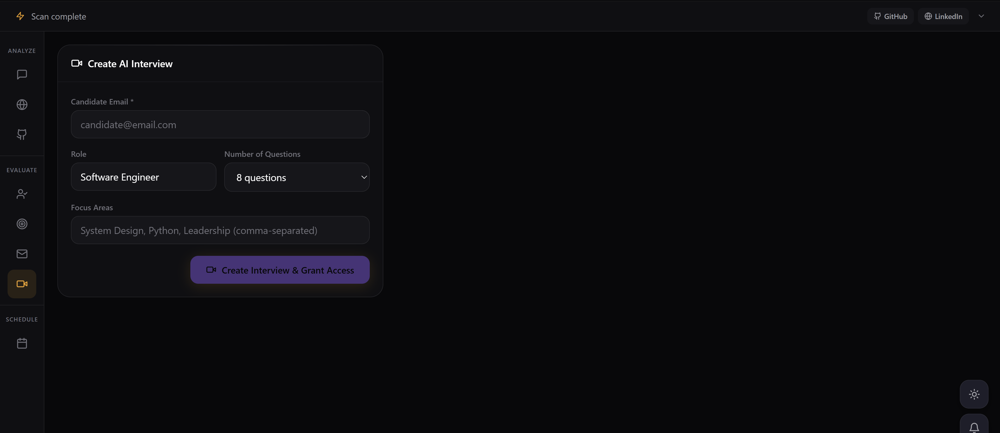
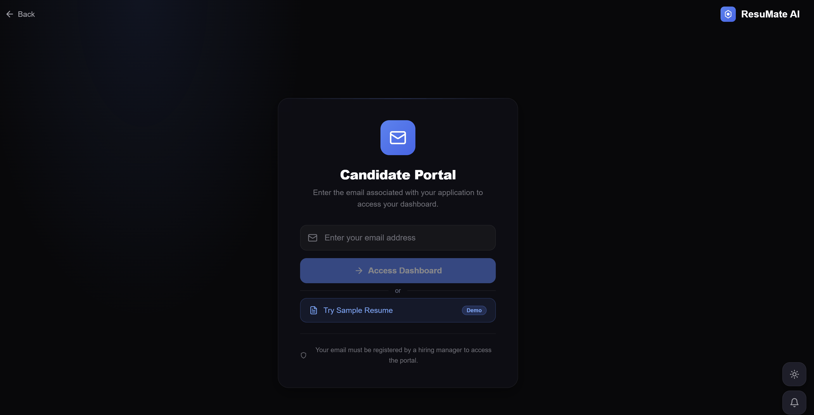
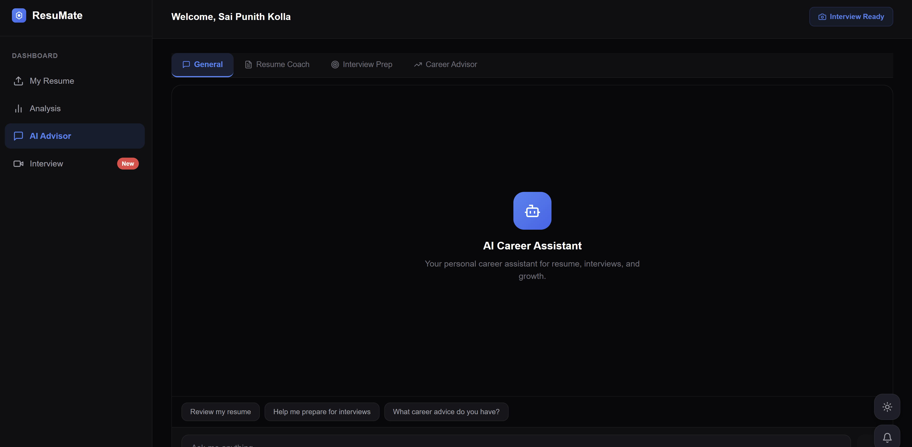
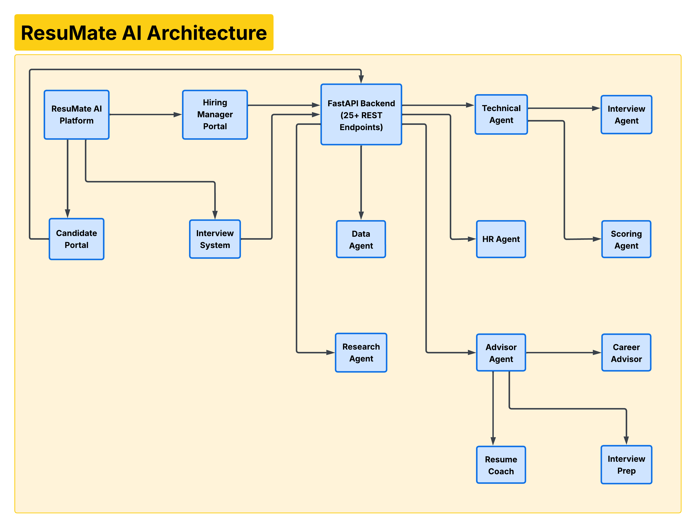
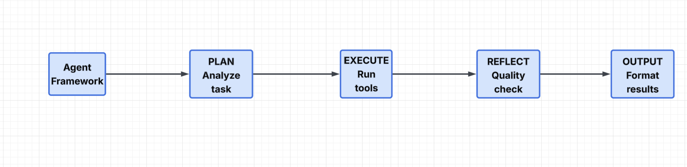

<p align="center">
  
  
  
  
  
  
  
  
</p>

# ResuMate AI

**A full-stack, multi-agent AI hiring platform**: résumé screening and evaluation, AI interviews,
career coaching for candidates, and Jarvis, a conversational copilot that runs the hiring pipeline by
voice or text.

**7 specialized AI agents** handle the work, from scanning candidates' profiles to interviewing them by
voice (or with a lip-synced video avatar), and Jarvis drives them all from one conversation.

---

## Demo

> **Live demo:** [resumate-ui.onrender.com](https://resumate-ui.onrender.com)
>
> *Free hosting: the server sleeps when idle and can take up to a minute to start. The app says so
> while it wakes.*

---

## Platform Preview

### Homepage
<p align="center">
  
</p>

The sign-in pages, and the legal, data-deletion and 404 pages, share the homepage's design. The dashboards
move to it next.

---

> The recordings below are from April 2026. The dashboards still look like this, but the recordings
> predate Screening, Find Candidates and Jarvis.

### Hiring Manager Dashboard

#### Upload & Analytics
<p align="center">
  
</p>

Upload résumés, view analytics, and rank candidates for a role.

#### AI Chat & Candidate Focus
<p align="center">
  
</p>

Multi-candidate AI chat, and a deep dive on one candidate with GitHub scanning and résumé intelligence.

#### Candidate Evaluation
<p align="center">
  
</p>

Evaluation reports with role fit, strengths and growth areas.

#### Interview Setup & Scheduling
<p align="center">
  
</p>

Create AI interviews, email the invitation (or share the sign-in link), draft emails, and schedule meetings.

---

### Candidate Portal

#### Login, Dashboard & Analytics
<p align="center">
  
</p>

Candidates sign in with a code emailed to them (the recording shows the earlier sign-in page), then see
their résumé analysis and personal analytics.

#### AI Advisor & Live Interview
<p align="center">
  
</p>

An AI career advisor for résumé coaching and interview prep, then the interview itself.

---

## Architecture

### System Overview
<p align="center">
  
</p>

The diagram predates two of the agents: **Jarvis**, which drives the others from one conversation, and
the **Sourcer Agent**, behind Find Candidates. Around the backend sit PostgreSQL (SQLite locally),
ChromaDB, where résumés are indexed, optional S3-compatible file storage, and the outside services: OpenAI,
Tavily, the GitHub API and SendGrid. Avatar interviews run through a separate worker
(`backend/interview_agent.py`) with LiveKit and Simli.

### Agent Framework
<p align="center">
  
</p>

The Data, HR, Technical and Research agents share this loop
([`backend/app/agents/base_agent.py`](backend/app/agents/base_agent.py)): they plan the steps, run
each one with retries, check the result and start again if it falls short, then write the output.
The Sourcer, the Advisor and Jarvis run flows of their own.

---

## Features

### Jarvis — AI Hiring Copilot

**Jarvis** turns the hiring manager's dashboard into one voice or text conversation. It sits on top of
screening, evaluation, enrichment, interviews, reports and export, and runs them for you.

Talk to Jarvis like a colleague:

- *"Screen everyone for a Python Developer role"* → scores every uploaded résumé and names the top candidates
- *"Check his GitHub"* → repos, languages, top projects, and a technical impression
- *"Give me his drawbacks"* → an evaluation with growth areas, fit and strengths
- *"Show me her resume red flags"* → gaps, verification targets and red flags
- *"Set up interviews for the top 3"* → creates the interviews, with an invitation draft for each
  (the card shows the first); *"send it"* emails those drafts
- *"Create an interview for Maya"* → one interview, with the sign-in link to send
- *"How did his interview go?"* → the report: the AI-written summary and, for video, proctoring
- *"Did he exaggerate on the resume?"* → compares the résumé's claims with the interview report
- *"Download the PDF report"* → the assessment report as a PDF
- *"What's the market rate for this role in Bangalore?"* → a web search with sources
- *"Share the Calendly link"* → the scheduling link set for the server (`CALENDLY_TOKEN`)

Jarvis keeps track of the active role, candidate and shortlist, so follow-ups like *"check his GitHub"*
or *"send it"* resolve without restating anything. Results appear as cards, most of which expand for
the detail.

---

### Find Candidates — Talent Mapping for the Entire Pool

Describe who you want in plain words: *"Backend engineer in Boston, strong Python, has shipped a real
product; ex-founder is a plus"*. The **Sourcer Agent** turns that into a few must-have and nice-to-have
criteria, then reads **everyone** it can reach (your uploaded résumés, GitHub, and public profiles found
by web search) and writes a judgement on every person, instead of keyword-filtering first.

- **Live talent map**: screened, judged, shortlisted, rate, time and cost so far, and a cell per person
- **Why filters would have missed them**: each shortlisted person is checked against the title +
  keyword search a recruiter would have run, with the reason it would have missed them
- **Scores you can check**: the model rates each criterion; the score is fixed arithmetic, so the same
  answers always give the same number
- **Human in the loop**: save, dismiss, and draft outreach; nothing is sent automatically
- **Public data only**, through official APIs; no LinkedIn scraping. A run reads up to a few hundred
  people, and says so when there were more

---

### Hiring Manager Portal
- **Résumé upload**: PDF, DOCX and TXT up to 5 MB, duplicates refused; each résumé becomes a structured
  profile (skills, experience, roles)
- **Screening**: ranks every candidate against a role on fixed, inspectable weights (skills, experience,
  role, education), with the breakdown shown
- **Résumé intelligence**: gaps, skills to verify, red flags
- **Scanner Agent**: finds the candidate's GitHub from the PDF's links or by web search, and LinkedIn from
  a link in the PDF
- **AI chat**: multi-candidate comparison over their profiles, voice in and out, anonymized mode
- **Hiring Agent**: evaluation against a role or job description
- **Credibility analysis**: the résumé's claims against the interview report
- **Email composer**: AI-drafted emails (interest, interview, offer, pass, follow-up), opened in your mail
  app to send
- **Interview creator**: format (voice or avatar), role, number of questions and focus areas; emails the
  invitation or gives the link
- **PDF report export**
- **Account deletion**: a manager can delete their account and everything in it

### Candidate Portal
- **Sign-in** with a code emailed to them: it lasts 15 minutes, and five wrong tries use it up
- **Résumé upload** with a replace flow
- **AI Advisor**: a general chat, plus three focused modes: Résumé Coach, Interview Prep, Career Advisor
- **The interview**: a voice conversation with an AI interviewer, or a video interview with an avatar
  where the server runs it (see below)
- **Interview report**: the transcript, the AI-written evaluation and the time taken, and proctoring for a
  video interview
- **Delete my data**: everything held about them, from the portal

### Interview System
- **Voice interviews**: OpenAI Realtime, speech to speech, straight from the browser with a short-lived
  key from the server; 8 minutes by default (`REALTIME_MAX_TOTAL_MINUTES`). The transcript is saved as
  it goes, and an AI-written report follows the interview
- **Avatar video interviews** (optional): LiveKit rooms with a lip-synced Simli avatar, run by a separate
  interview worker. They need `AVATAR_INTERVIEWS=true`, the LiveKit settings and `AGENT_SHARED_SECRET`,
  and the worker running; otherwise interviews run voice-only
- **Questions made for the candidate**: an interview created on its own gets questions from the role and
  a gap analysis of the résumé; interviews made in a batch use standard questions
- **Proctoring** (video): face-in-view tracking, tab and window monitoring, fullscreen; 3 violations end
  the interview
- **Consent first**: before it starts, the candidate is told what happens (what they say is transcribed
  and saved; AI writes a report from the transcript, with a hiring recommendation; on video, the camera
  checks they stay in view) and agrees; the agreement is recorded
- **One go**: a finished interview can't be retaken

### Analytics
- **Candidates**: skills, experience, roles and levels for the selected candidates
- **Interviews**: how many are completed, by role, and the recent ones, each opening its report

Interview answers are not scored: per-answer scoring was removed on 2026-10-10, so score fields in
reports and analytics show "—".

---

## Tech Stack

| Layer | Technology |
|-------|-----------|
| **Frontend** | React 18, Vite 6, React Router 7, Tailwind 4, Lucide icons; tests with Vitest. The fonts (DM Sans, Instrument Serif, JetBrains Mono) ship with the app |
| **Backend** | FastAPI, Python 3.12, SQLAlchemy (async), Alembic, Uvicorn |
| **Database** | PostgreSQL in production, SQLite locally and in tests |
| **AI** | OpenAI (chat model set by `OPENAI_MODEL`, default `gpt-4o`), embeddings, Whisper, TTS, Realtime |
| **Vector store** | ChromaDB with LangChain: résumés are indexed there, and removed with their candidate (the chat reads the candidates' profiles directly) |
| **File storage** | Optional S3-compatible storage keeps the original résumé files; without it, they are read and then discarded |
| **Interviews** | OpenAI Realtime (voice); LiveKit Cloud + Simli (avatar, optional) |
| **Search** | Tavily (web), GitHub API |
| **Email** | SendGrid |
| **Hosting** | Render (API, frontend, Postgres); the optional avatar worker on Fly.io or a paid Render worker |

---

## 7 Specialized Agents

| Agent | Role | Tools |
|-------|------|-------|
| **Jarvis** | Conversational copilot: screening, evaluation and interviews by voice or text | OpenAI, the agents below, TTS/STT |
| **Data Agent** | Profile scanning and enrichment: GitHub, LinkedIn, links in the PDF | GitHub API, Tavily, PDF reading |
| **HR Agent** | Evaluation, email drafting, hiring recommendations | OpenAI, salary research |
| **Technical Agent** | Interview questions, résumé intelligence, credibility analysis | OpenAI, Tavily |
| ↳ Interview Agent | Conducts the interview: the voice interviewer, or the avatar worker | OpenAI Realtime, LiveKit, Simli lip-sync |
| **Research Agent** | Web search with sources | Tavily |
| **Sourcer Agent** | Finds people beyond your uploads and judges every one | GitHub API, Tavily, OpenAI |
| **Advisor Agent** | Career coaching for candidates (a general chat and 3 focused modes) | OpenAI, résumé context |

Jarvis and the Advisor use `gpt-4o`; the other agents use `OPENAI_MODEL` (default `gpt-4o`), and the
Sourcer can use its own cheaper model (`SOURCER_MODEL`).

---

## How It Works

### Hiring Manager Flow

**On the dashboard:**
```
Upload résumés → each becomes a structured profile
     ↓
Screen → candidates ranked for the role
     ↓
Scan and résumé intelligence → GitHub and LinkedIn; gaps, verification targets, red flags
     ↓
Hiring Agent → evaluation against the job description
     ↓
Create interview → questions made from the résumé analysis
     ↓
Invite → the invitation emailed, or the sign-in link to send
     ↓
After the interview → report, credibility analysis, PDF export
```

**With Jarvis (voice or text):**
```
"Screen everyone for a Python Developer"     → ranks them, names the top candidates
"Check his GitHub" / "Give me his drawbacks" → works on the candidate in focus
"Set up interviews for the top 3"            → interviews made, invitation drafts shown
"Send it"                                    → the drafts are emailed
```

### Candidate Flow
```
Sign in with an emailed code → access given by the hiring manager
     ↓
Upload a résumé → AI analysis
     ↓
AI Advisor → General | Résumé Coach | Interview Prep | Career Advisor
     ↓
The interview → told what happens, agree, then voice (or avatar video) with the AI interviewer
     ↓
Report → transcript, AI-written evaluation, time (and proctoring, for video)
```

---

## Project Structure

```
backend/
  main.py               the API app and its routes
  app/api/              one file per area: auth, candidates, chat, jarvis, sourcer, privacy…
  app/agents/           the agents, and the loop most of them share
  app/services/         email, file storage, résumé search, sign-in codes, deletion…
  app/models/           the database tables
  alembic/              the database migrations
  tests/                the backend tests (pytest)
  interview_agent.py    the optional avatar-interview worker (Dockerfile.agent, fly.toml)
  scripts/              backup_db.py, make_sample_resume.py
frontend/
  src/components/       the pages and their parts; home/ and auth/ hold the new design
  src/styles/           the stylesheets; studio.css and studio-auth.css are the new design
  src/services/         API calls, sign-in sessions, notices
render.yaml             the Render deployment
.github/workflows/      CI
screenshots/            the README's images
tools/                  fix_mojibake.py, which repairs text garbled by a wrong encoding
```

## Run It Locally

You need Python 3.12 and Node 20.19+, 22.13+ or 24 (CI uses Python 3.12 and Node 24).

**Backend** (API on port 8006):
```bash
python -m venv venv
source venv/bin/activate            # Windows: venv\Scripts\activate
pip install -r backend/requirements.txt
cp backend/.env.example backend/.env   # then set SECRET_KEY and OPENAI_API_KEY
cd backend
uvicorn main:app --reload --port 8006
```
In `backend/.env`, also clear `TAVILY_API_KEY`, `GITHUB_TOKEN` and `CALENDLY_TOKEN` unless you have real
ones: the example's placeholder values count as set, and GitHub refuses a made-up token where it would
answer without one.

Locally the database is SQLite (`backend/resumate.db`), created on start. With `DEBUG=true` and no email
set up, nothing is emailed: the data-deletion code and the password-reset link are shown in the app, and
a candidate's sign-in code is printed in the backend's console.

**Frontend** (on port 3006, proxying `/api` to the backend):
```bash
cd frontend
npm ci
npm run dev
```

## Configuration

The backend's settings are listed, most with a comment, in [`backend/.env.example`](backend/.env.example).
The ones that matter most:

| Variable | What it does |
|----------|--------------|
| `SECRET_KEY` | Signs sign-in tokens. Required in production; the app won't start with a weak one |
| `DEBUG` | `true` only locally: relaxes the key check, and lets the app work without email (see above) |
| `DATABASE_URL` | Postgres in production; SQLite by default |
| `OPENAI_API_KEY`, `OPENAI_MODEL` | The AI agents, and the model they use |
| `FRONTEND_URL` | Where invitation and password-reset links point |
| `CORS_ORIGINS` | The frontend addresses allowed to call the API, comma-separated |
| `SENDGRID_API_KEY`, `FROM_EMAIL` | Email: sign-in codes, invitations, password resets, deletion codes |
| `TAVILY_API_KEY`, `GITHUB_TOKEN` | Web search, and GitHub lookups and sourcing |
| `CALENDLY_TOKEN` | The scheduling link Jarvis and the dashboard share |
| `AVATAR_INTERVIEWS`, `LIVEKIT_*`, `AGENT_SHARED_SECRET` | Avatar interviews; the secret lets the worker report back. `SIMLI_*` are the worker's own |
| `S3_BUCKET`, `S3_*` | Optional storage for the original résumé files, so managers can download them again |
| `VITE_API_URL` | The frontend's one setting, read when it is built: the API's address in production |

## Tests

```bash
cd backend && pytest -q                       # the API, agents and services, on a throwaway SQLite file
cd frontend && npm run lint && npm test       # lint, then the frontend tests
```
The backend tests still read `backend/.env`, so run them with one that holds no real keys: with a real
SendGrid key in it, a test can send real email.

CI ([`.github/workflows/ci.yml`](.github/workflows/ci.yml)) runs both, builds the frontend, and builds a
Postgres 16 database from empty with the migrations. It then checks the database matches the models and
the app starts on it, and takes the migrations back down and up again.

## Deploying, and the Free Plan

[`render.yaml`](render.yaml) deploys the API, the frontend and Postgres on Render's free plan;
[`backend/DEPLOY.md`](backend/DEPLOY.md) has the details. What the free plan means:

- **The server sleeps** after about 15 idle minutes and takes up to a minute to start again. The app tells
  people while it wakes.
- **The free database expires 30 days after it is created**, and Render deletes it 14 days later unless
  it is upgraded. Back it up about every three weeks with `backend/scripts/backup_db.py` (it needs
  PostgreSQL 16's `pg_dump` and `pg_restore`), and restore into a new one when it expires (steps in
  DEPLOY.md).
- **Avatar interviews are off**: they need a worker process, which the free plan doesn't run. Interviews
  run voice-only until you run the worker and set `AVATAR_INTERVIEWS=true`. The worker
  (`backend/interview_agent.py`) can run on Fly.io with `backend/fly.toml` and `backend/Dockerfile.agent`,
  or as a paid Render worker, left commented out in `render.yaml`.
- **Email needs SendGrid** with a verified sender (`FROM_EMAIL`), and in production the app depends on
  it. Without it, invitations aren't emailed (the app gives the manager the sign-in link to send), but
  candidates can't get the code that link asks for, and password resets and deletion codes don't
  arrive either.
- **A deployment of your own** gets its own addresses, so set `VITE_API_URL` on the frontend, and
  `FRONTEND_URL` and `CORS_ORIGINS` on the API, to match them. Otherwise the frontend calls the original
  demo's API.

## Data and Privacy

- **Consent**: managers agree to the Terms and Privacy Policy at sign-up; candidates agree before an
  interview starts. Both are recorded.
- **Deletion**: a candidate can delete their data from the portal. Anyone else, such as someone whose
  résumé a manager uploaded, can ask at `/privacy/delete`: an emailed code confirms it, and the page never
  reveals whether anything was held. It finds data by email address, and people a search found are
  usually kept without one; a manager removes them by deleting the search. Managers can delete their
  account and all its data.
- **Separation**: each manager sees only their own candidates and interviews.
- **Backups** hold personal data: they are git-ignored, and never CI artifacts (the repository is public).

## Status and Roadmap

- **The new design**: the homepage, the sign-in pages, and the legal, data-deletion and 404 pages are in
  it. The hiring and candidate dashboards are next.
- **Legal text**: the Terms of Service and Privacy Policy pages hold placeholder text, marked as such,
  until reviewed legal text replaces it.

## Security and Conduct

Report a security problem privately by email, as [SECURITY.md](SECURITY.md) describes, not in a public
issue. Everyone taking part in the project follows the [Code of Conduct](CODE_OF_CONDUCT.md).

---

## License

All Rights Reserved. See [LICENSE](LICENSE) for details.

---

<p align="center">
  Built by <strong>Sai Punith Kolla</strong>
</p>
